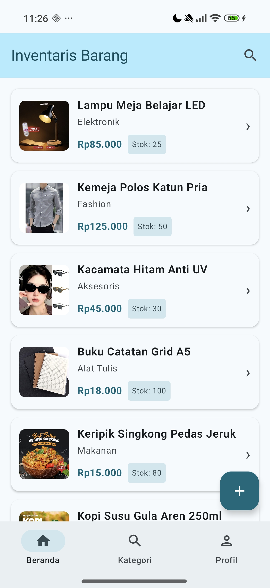
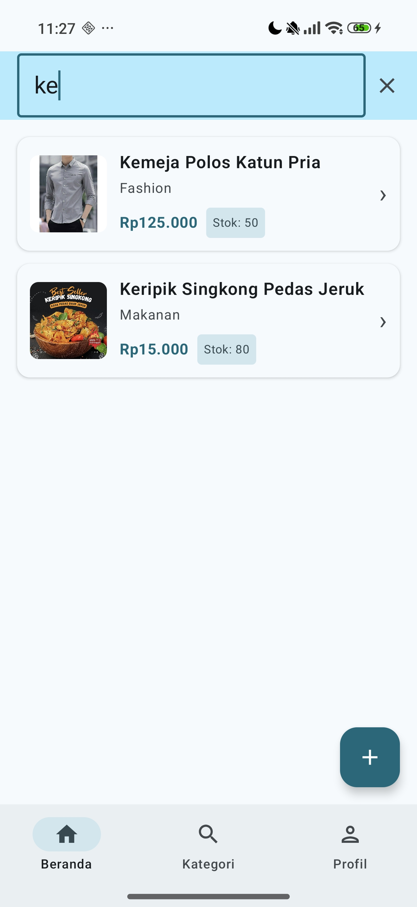
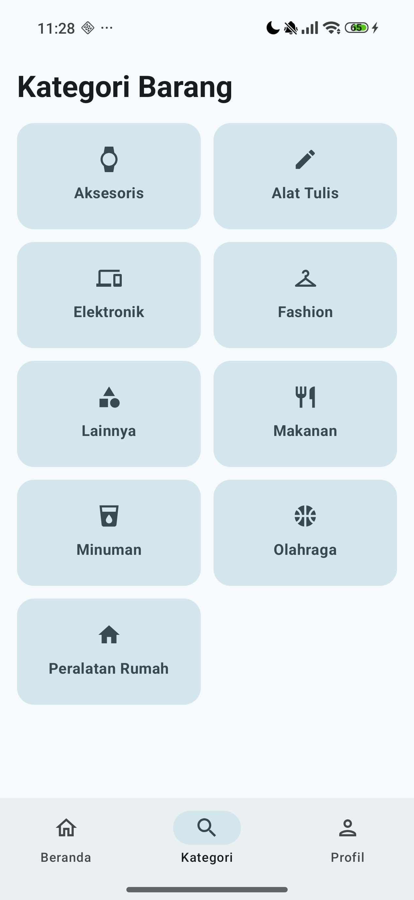
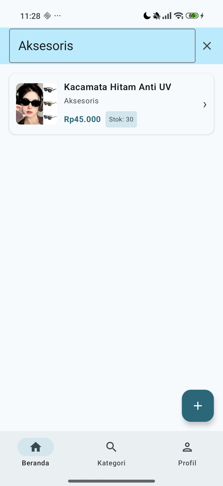
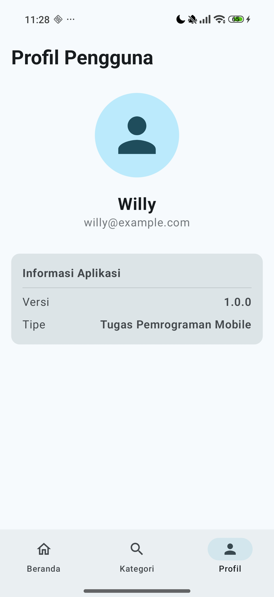
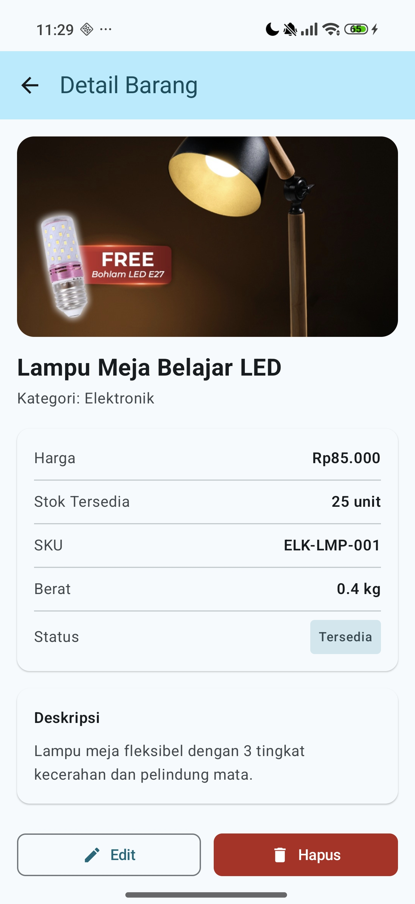
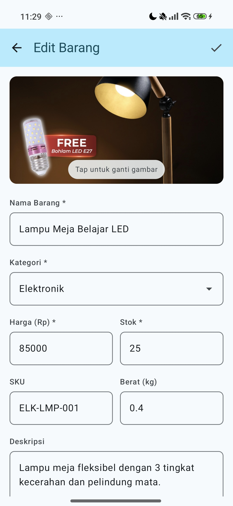
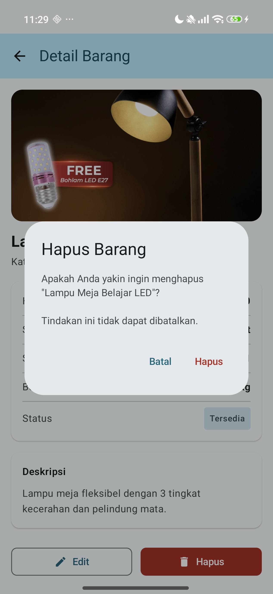
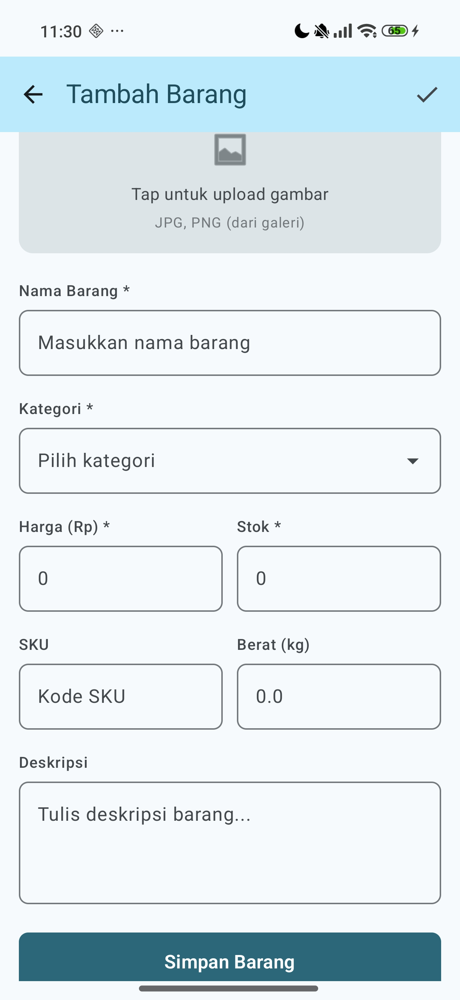

# Inventaris Barang — Jetpack Compose Android App

Aplikasi manajemen inventaris barang sederhana menggunakan **Jetpack Compose**, **Navigation Compose**, dan **SharedPreferences** untuk penyimpanan lokal. Proyek ini dikembangkan sebagai bagian dari tugas mata kuliah Pemrograman Mobile.

---

## Identitas Mahasiswa

- **Nama**: Willy Rafael F. Silalahi
- **NIM**: 23083000168
- **Kelas**: 6A2
- **Matakuliah**: Pemrograman Mobile
- **Intansi**: Universitas Merdeka Malang

---

## Tentang Proyek

Aplikasi **Inventaris Barang** dirancang untuk membantu pengguna mengelola data stok barang secara digital. Aplikasi ini memungkinkan pengguna untuk mencatat barang baru, melihat detail informasi barang, mengelompokkan berdasarkan kategori, serta melakukan pencarian dengan cepat. Data disimpan secara lokal di perangkat menggunakan SharedPreferences dalam format JSON, sehingga data tetap tersimpan meskipun aplikasi ditutup.

---

## Fitur Utama

| Fitur | Keterangan |
|-------|------------|
| **Daftar Barang** | Menampilkan semua barang menggunakan `LazyColumn` dengan fitur pencarian dan badge stok otomatis. |
| **Kategori Barang** | Layar khusus yang menampilkan daftar kategori unik dengan ikon spesifik untuk setiap jenis barang. |
| **Detail Barang** | Informasi lengkap barang termasuk gambar besar, harga, stok, SKU, berat, dan deskripsi. |
| **Tambah/Edit Barang** | Formulir input lengkap dengan validasi dan fitur upload gambar dari galeri perangkat. |
| **Penyimpanan Lokal** | Menggunakan `SharedPreferences` + `Gson` untuk persistensi data yang ringan dan cepat. |
| **Data Dummy** | Otomatis mengisi data contoh saat aplikasi pertama kali dijalankan jika daftar masih kosong. |
| **UI Modern** | Menggunakan `Material3` dengan dukungan `Dynamic Color` dan layout yang responsif. |
| **Navigasi Tab** | Bottom Navigation Bar untuk berpindah antar Beranda, Kategori, dan Profil dengan mudah. |

---

## Screenshot Aplikasi

| Tampilan Beranda | Fitur Pencarian |
| :---: | :---: |
|  |  |
| Daftar barang dengan data dummy otomatis | Pencarian barang berdasarkan nama/kategori |

| Daftar Kategori | Filter Kategori |
| :---: | :---: |
|  |  |
| Pengelompokan barang berdasarkan jenis | Menampilkan barang sesuai kategori dipilih |

| Tampilan Profil | Tampilan Detail |
| :---: | :---: |
|  |  |
| Informasi pengguna dan aplikasi | Informasi lengkap dan spesifikasi barang |

| Edit Barang | Hapus Barang |
| :---: | :---: |
|  |  |
| Mengubah data barang yang sudah ada | Dialog konfirmasi penghapusan barang |

| Tambah Barang |
| :---: |
|  |
| Formulir input barang baru |

---

## Cara Menjalankan Project

### 1. Prasyarat
- **Android Studio** (Versi Ladybug / Koala ke atas direkomendasikan).
- **Android SDK** minimal versi 26 (Android 8.0 Oreo).
- **Git** terinstal di komputer Anda.

### 2. Kloning Repositori
Buka terminal atau command prompt, lalu jalankan perintah:
```bash
git clone https://github.com/willyrafaelfs/Pemrograman-Mobile-Inventaris-Barang.git
```

### 3. Membuka di Android Studio
1. Buka **Android Studio**.
2. Pilih **File → Open**.
3. Arahkan ke folder hasil kloning (`Pemrograman-Mobile-Inventaris-Barang`).
4. Tunggu proses **Gradle Sync** selesai (pastikan terkoneksi internet).
5. Sambungkan perangkat Android atau jalankan Emulator.
6. Klik tombol **Run ▶** (Shift + F10).

---

## Struktur Folder

```
InventarisBarang/
├── app/src/main/
│   ├── AndroidManifest.xml
│   ├── java/com/example/inventarisbarang/
│   │   ├── MainActivity.kt                    ← Entry point
│   │   ├── model/
│   │   │   └── Barang.kt                      ← Data class
│   │   ├── data/
│   │   │   └── BarangRepository.kt            ← CRUD SharedPreferences
│   │   ├── navigation/
│   │   │   └── AppNavigation.kt               ← Route definitions
│   │   ├── screen/
│   │   │   ├── MainScreen.kt                   ← Host Bottom Navigation
│   │   │   ├── DaftarBarangScreen.kt           ← Tab Beranda
│   │   │   ├── KategoriScreen.kt               ← Tab Kategori
│   │   │   ├── ProfileScreen.kt                ← Tab Profil
│   │   │   ├── DetailBarangScreen.kt           ← Detail Barang
│   │   │   └── TambahBarangScreen.kt           ← Form Tambah/Edit
│   │   └── ui/theme/
│   │       └── Theme.kt                       ← Material3 theme
│   └── res/
│       ├── drawable/                           ← Icon & resource grafis
│       └── values/                             ← Themes, strings, colors
├── screenshots/                                ← Folder gambar dokumentasi
├── build.gradle.kts                            ← Project-level
└── settings.gradle.kts
```

---

## Teknologi yang Digunakan

- **Jetpack Compose**: Untuk membangun UI deklaratif yang modern.
- **Navigation Compose**: Untuk mengelola perpindahan antar layar.
- **Material 3**: Standar desain terbaru dari Google.
- **Coil**: Library untuk memuat gambar dari URI secara asinkron.
- **Gson**: Untuk serialisasi objek ke format JSON.
- **Kotlin 2.1**: Bahasa pemrograman utama yang digunakan.
